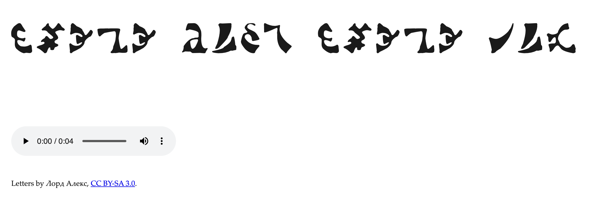

.png)

# Enochaeon

Enochaeon is a spoken cipher. A text file is transliterated, letter by letter, from English into Hebrew and then into [Enochian](https://en.wikipedia.org/wiki/Enochian), the angelic language John Dee, Elizabeth I's astrologer, recorded in 1583. Each English word is spoken as one breath of the sounds assigned to those Enochian letters. A phone recognizer hears the breath, the same key turns the letters back into English, and a word list corrects a reading that is not an English word. [Deciphered text](example/pangram.decoded.txt) will likely have imperfections, which was decoded from this [file](https://github.com/user-attachments/assets/8c50c9ac-33a0-4877-99f9-c73b2ea6ccb7). English to Enochian translations use a more natural sounding TTS (see mp4 example below).

**Translation** speaks an English phrase as Enochian words. The phrase is matched to the English glosses in the [lexicon](calls/lexicon.json), and each match is spoken from that word's pronunciation. 

The **Calls** can be spoken too. A file in `calls/` is already Enochian, and each spelling is spoken from the pronunciation stored for it.

How the three paths work, and the files they read, is in [`docs/enochaeon-in-theory-and-practice.md`](docs/enochaeon-in-theory-and-practice.md).

The name Enochaeon joins Enoch, the prophet who spoke with the angels, and the Greek *aeon*, an epoch or age.

**This is still a WIP, and I am currently building out and verifying the lexicon.** Update 11-11-2026, I believe the Lexicon is in solid enough shape to be used, but I plan to do more analysis with it.

## Setup

```bash
brew install espeak-ng
pip install -e .
python3 -m piper.download_voices --download-dir scratch/piper-voices en_US-john-medium
enochaeon calibrate
```

## Voice

Calls and translations are spoken with [`enochaeon.json`](enochaeon.json). The cipher stays on espeak.

```json
{
  "calls": {
    "engine": "piper",
    "ipa": "dee_ipa",
    "piper": {
      "length_scale": 1.6,
      "word_ms": 200,
      "voice": "scratch/piper-voices/en_US-john-medium.onnx",
      "ipa": "dee_ipa_piper_john",
      "word_end": "."
    }
  }
}
```

- `calls.engine` is `piper` or `espeak`. `--engine` overrides one Call run.
- `calls.ipa` is `dee_ipa` or `golden_dawn_ipa`. Both are fields of `calls/lexicon.json`, which is the one place that says how a word is said. `golden_dawn_ipa` is empty.
- `calls.piper.voice` is the model downloaded in Setup.
- `calls.piper.ipa` is the lexicon field that lists what this Piper voice is given for each spelling. It is sent as written. Leave it out and Piper is given `calls.ipa`.
- `calls.piper.word_end` is the mark that ends each word given to Piper.
- `calls.piper.length_scale` is how long Piper holds each phoneme. `1.0` is conversational, and higher is slower.
- `calls.piper.word_ms` is the silence between Piper breaths, in milliseconds. Leave it out and Piper keeps the 600 milliseconds espeak uses.

## Use

```bash
enochaeon notes.txt    # writes notes.wav and the three stage files
enochaeon notes.wav    # prints the text and writes notes.decoded.txt
enochaeon calls        # speaks every .txt in ./calls
enochaeon calls calls/01.txt # speaks one call 
enochaeon translate ritual.txt #translate English text into spoken Enochian
```

Pass a `.txt` file of Enochian spellings to `enochaeon calls`. The wav is written beside that file.

`enochaeon translate` writes a wav beside the English file, and `.enochaeon/<stem>-enochian.txt` lists the Call words that wav speaks. The same run writes `<stem>.html` beside the wav, showing the spoken spellings in Enochian letters and playing the recording. An English word with nothing close stays in that file in brackets and is left out of the wav. The wav is not read back.

An [example](example/pangram.html) of the Enochian generated text:



### Stage files

The stage files go in a hidden folder next to the source. For `notes-test.txt` they are:

```text
.enochaeon/notes-test-hebrew.txt
.enochaeon/notes-test-enochian.txt
.enochaeon/notes-test-phonetic.txt
```

Hebrew is the pointed transliteration. Enochian is the letter names. Phonetic is one espeak string per English word, the breath espeak speaks.

## Example

[`example/pangram.txt`](example/pangram.txt) is the pangram. Encoding it writes the WAV and the three stage files.

- [`example/.enochaeon/pangram-hebrew.txt`](example/.enochaeon/pangram-hebrew.txt) is the pointed Hebrew spelling.
- [`example/.enochaeon/pangram-enochian.txt`](example/.enochaeon/pangram-enochian.txt) is the Enochian letter names.
- [`example/.enochaeon/pangram-phonetic.txt`](example/.enochaeon/pangram-phonetic.txt) is the espeak string, one breath per English word.
- [`example/pangram.wav`](example/pangram.wav) is that breath spoken.
- [`example/pangram.decoded.txt`](example/pangram.decoded.txt) is the English recovered from that WAV.

https://github.com/user-attachments/assets/a6e506eb-6648-491f-80e6-3c3d229bb94f

[`example/First Call.wav`](example/First%20Call.wav) is a spoken reading of [`calls/01.txt`](calls/01.txt).

An output that is already there is left alone unless you pass `--force`. A WAV made here carries a short comment with the gap lengths and no plaintext. A WAV without that comment is still decoded, with a warning.

## License

Copyright 2026 Eddie Gonzales. This work is licensed under a [Creative Commons Attribution 4.0 International License](https://creativecommons.org/licenses/by/4.0/).

`src/enochaeon/data/words.txt` is SCOWL and keeps the terms in [`SCOWL-Copyright.txt`](src/enochaeon/data/SCOWL-Copyright.txt). The Enochian letters in [`enochian.ttf`](src/enochaeon/data/enochian.ttf) are by Лорд Алекс and stay under [CC BY-SA 3.0](src/enochaeon/data/enochian-letters-license.txt).
