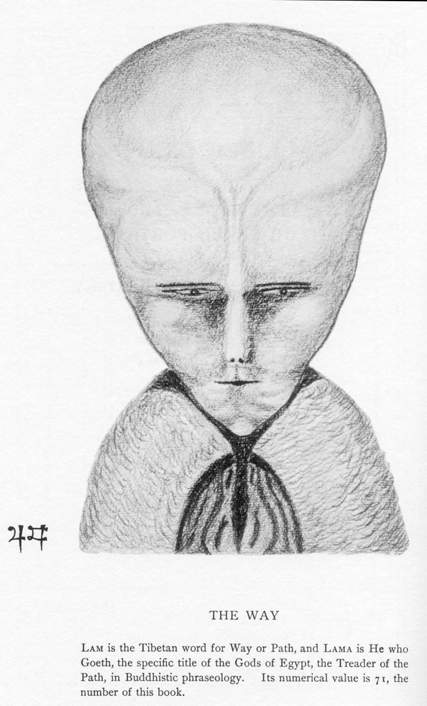

# How Enochaeon works

Enochaeon has three paths. They do not share a pronunciation.

The cipher turns an English text file into Hebrew, then into Enochian letters, speaks those letters, and can read the recording back into English. Translate speaks an English phrase as Call words by matching it to the lexicon. A Call file is already Enochian, and each spelling is spoken from the pronunciation stored for it.

## The cipher

English goes through Hebrew on purpose. Dee's own table pairs each of the 21 Enochian characters with one Elizabethan letter, so `fox` would be Orth, Med, Pal: F, O, X. That table has one letter for `u` and `v`, and one letter for `c` and `k`. `w` is two Vans. `th` and `sh` are two letters each, so `the` is Gisg, Na-hath, Graph. The way back cannot spell a distinction that was never spoken. A word list can prefer `over` to `ouer` only when one of them is a word.

The Hebrew key keeps those distinctions. `u` and `v` are different letters, and so are `c` and `k`. `th` and `sh` are one letter each, which is why `the` and `she` are a consonant plus a vowel. `x` is two letters, Ger and Pal, and that is the same pair a written `k` followed by `s` becomes.

Those pairs are traditional, not a table invented here. Each Enochian name answers to a Hebrew letter, the correspondence the Golden Dawn used and the one Leitch records. An English word is spelled with those Hebrew letters, and the names are read off. Aleph is Un, so `a` could be written as a two-column row. Hebrew is what makes the other rows: bet with a dagesh is `b` and bet without one is `v`, yod is `i` and `y`, vav is `o` and `u`, and `w` is two vavs. A Latin table of different pairs would be a different cipher. The Hebrew column stays so this tradition stays visible. The speech and the round trip use the Enochian letters that row chose.

Every word is spelled the same way. The reference is the pangram in [`example/pangram.txt`](../example/pangram.txt), and `fox` is one word from it:

- `f` is peh without a dagesh, פ. Its Enochian letter is Mals.
- `o` is vav with a cholam, וֹ. Its Enochian letter is Vau.
- `x` is kuf plus samekh, קס. Those letters are Ger and Pal.

In Latin letters that spelling is `PVQS`. O counts as a vowel, so fox is one breath of syllables, not letter-names. A vowel left open is long, a vowel closed by a consonant is short, and a doubled consonant is spoken twice. `Hello` is `HELLV`. Capitals are folded to lowercase.

The key is [`src/enochaeon/data/alphabet.json`](../src/enochaeon/data/alphabet.json). Matching is longest-first, so `ch`, `sh`, `th`, `ts`, and `x` are one row each. `tz` is the same Hebrew and the same Enochian letters as `ts`, and it comes back as `ts`. A written `k` followed by `s` is the same letters as `x`, so `foks` comes back as `fox`.

An English word is always those in-word syllables, including a word with no vowel. The espeak phones in the key are this project's, chosen so a recognizer can tell the letters apart. They are not a historical pronunciation. A comma stays on the line, and a period starts a new line.

`enochaeon notes.txt` writes three stage files in `.enochaeon/` beside the source, then `notes.wav`. Hebrew is the pointed transliteration. Enochian is the letter names. Phonetic is one espeak string per English word, the breath espeak speaks. The wav carries a short comment with the gap lengths and no plaintext. Encoding and decoding both refuse to run until calibration exists.

Hearing uses [espeak-ng](https://github.com/espeak-ng/espeak-ng) and `facebook/wav2vec2-lv-60-espeak-cv-ft`. `enochaeon calibrate` speaks every letter sound once, in a short carrier, and stores what the model actually hears in [`src/enochaeon/data/calibration.json`](../src/enochaeon/data/calibration.json). Two hearings are the same when they match after length, the a/ɑ difference, and a few recognizer spellings of the same phone are ignored. If two letters collide, change the `phone` or `long` string for one of them and calibrate again.

`enochaeon notes.wav` aligns the heard phones to those calibrated syllables and inverts the key. The raw reading is then checked against an English word list. A reading that is already in the list is kept. A reading that is not is replaced only when a listed word is within a few phone edits. A vowel edit is cheaper than a consonant edit. The list will keep a real word even when it is the wrong one. The recovered text is written as `notes.decoded.txt`. A wav without the gap comment is still decoded, with a warning.

The cipher does not read `enochaeon.json`, the lexicon, or a Call file. It stays on espeak.

| File | Role |
| --- | --- |
| `src/enochaeon/data/alphabet.json` | Hebrew and Enochian for each English spelling, and the espeak phones |
| `src/enochaeon/data/calibration.json` | What the recognizer heard for each letter. Written by `enochaeon calibrate` |
| `src/enochaeon/data/words.txt` | The English word list used on the way back |
| `src/enochaeon/alphabet.py` | Loads the key and applies the length rule |
| `src/enochaeon/encode.py` | Stage files and the cipher wav |
| `src/enochaeon/decode.py` | The wav read back into English |
| `src/enochaeon/calibrate.py` | Builds `calibration.json` |
| `src/enochaeon/recognize.py` | The phone recognizer |
| `src/enochaeon/match.py` | Aligns a hearing to the calibrated syllables |
| `src/enochaeon/lexicon.py` | Chooses an English word within a few phone edits |
| `src/enochaeon/synthesize.py` | espeak-ng |

## The lexicon

Calls and translation both read [`calls/lexicon.json`](../calls/lexicon.json). The cipher does not. One entry is a root, the other spellings of that root, the English words it answers to, and two pronunciations.

```json
{
  "root": "BALT",
  "variants": ["BALTIM", "BALTOH", "BALZIZRAS"],
  "pos": "noun",
  "english_glosses": ["justice", "righteousness", "judgment"],
  "hebrew_skeleton": "ב-א-ל-ת",
  "dee_ipa": "/b.æ.l.t/",
  "golden_dawn_ipa": "",
  "sources": ["Key 1", "Key 5", "Key 11"]
}
```

`root` and `variants` are the spellings. They share the glosses and the part of speech. `english_glosses` are what translation matches. `pos` is the part of speech used when more than one gloss is close. `dee_ipa` on the root is the letter rule for that root. A variant is spoken with the letter rule of its own spelling. `golden_dawn_ipa` is empty. `calls.ipa` chooses which field is spoken. `hebrew_skeleton` and `sources` stay in the file and are not read. How the Dee reading is made is [dee-ipa.md](dee-ipa.md).

A Call looks up the spelling that is written. `Iad` is this entry, and it is spoken `/j.æ.d/`:

```json
{
  "root": "IAD",
  "variants": ["IAD", "IADO"],
  "pos": "noun",
  "english_glosses": ["God", "the Divine"],
  "dee_ipa": "/j.æ.d/",
  "golden_dawn_ipa": ""
}
```

`iado` is spoken `/j.æ.d.oʊ/`, the letter rule of that spelling. `Mad` is a different entry, `/m.æ.d/`, even though it also lists `God`. A Call that says `Iad` does not become `Mad`.

Translation starts from the English. `justice` is an exact gloss of the `balt` family, so the trace writes `balzizras`, the spelling that appears in the most Call files. The wav speaks `/b.æ.l.z.ɪ.z.r.æ.s/`, the letter rule of `balzizras`. `fire` is an exact gloss of `prge`, whose `dee_ipa` is `/p.r.ɡ.eɪ/`.

`Speak foobar into the fire.` is written `camliax [foobar] a manin prge.`

- `speak` is an exact gloss of `camliax`.
- `foobar` scores 0.417 against the nearest gloss, under 0.50, so it stays in brackets and is left out of the wav.
- `into` is nearest to `in`, a gloss of `a`, at 0.761.
- `the` is nearest to `the mind`, a gloss of `manin`, at 0.549.
- `fire` is an exact gloss of `prge`.

## Calls

A file in [`calls/`](../calls) is already Enochian, written in Dee's Latin letters. `01.txt` through `18.txt` are the first eighteen Keys. `19-lil.txt` through `48-tex.txt` are the Call of the Aethyrs, the same words with that aethyr's name. Nothing in a Call is transliterated into Hebrew or into the English cipher.

`enochaeon calls` speaks every `.txt` in `./calls`. `enochaeon calls calls/01.txt` speaks one file. Each file gets a sibling `.wav`. A spelling is looked up in the lexicon, and the field named by `calls.ipa` is what is spoken. A spelling with no reading is left out of the recording and printed. A file with no readable word writes no wav.

`dee_ipa` is the letter rule for the spelling that is written. [dee-ipa.md](dee-ipa.md) is how that string is made, and where it can still disagree with the syllables Dee wrote in the margins. `golden_dawn_ipa` is empty. Calls 49 and 50 are not part of Dee's forty-eight Keys. Only the 50th call has English for its new spellings, from Crowley's footnote.

Piper speaks the IPA. espeak speaks phonemes derived from that same string. `calls.engine` in [`enochaeon.json`](../enochaeon.json) chooses which one. `--engine espeak` or `--engine piper` overrides that for one Call run. `calls.piper.voice` is John's model, downloaded into `scratch/piper-voices/`. `calls.piper.length_scale` is how long Piper holds each phoneme. `1.0` is conversational, and higher is slower. `calls.piper.word_ms` is the silence between Piper breaths. espeak keeps 600 milliseconds between words. A Call wav carries the same gap comment as a cipher wav.

A comma stays on the line, and a period starts a new line.

| File | Role |
| --- | --- |
| `calls/*.txt` | Dee's Latin spellings |
| `calls/lexicon.json` | Gloss, part of speech, `dee_ipa`, and `golden_dawn_ipa` for each root and variant |
| `enochaeon.json` | Engine, IPA field, Piper voice, length, and the Piper gap |
| `scratch/piper-voices/` | John's voice. The download creates this directory. It is not in git |
| `src/enochaeon/enochian.py` | Reads a Call file and leaves out a spelling with no reading |
| `src/enochaeon/roots.py` | Loads the lexicon |
| `src/enochaeon/word_ipa.py` | Turns the stored IPA into Piper or espeak phonemes |
| `src/enochaeon/piper_voice.py` | Piper |
| `src/enochaeon/config.py` | Reads `enochaeon.json` |

## Translate

`enochaeon translate ritual.txt` speaks an English phrase as Call words. This is not the cipher, and the wav is not read back. The command writes `ritual.wav` beside the source, and `ritual.html` beside that wav, showing the spoken spellings in Enochian letters and playing the recording. `.enochaeon/ritual-enochian.txt` lists the Call words that wav speaks. There is no Hebrew file and no phonetic file. The wav uses the same `calls.ipa` reading as the Calls, and the same voice in `enochaeon.json`.

An exact gloss wins, and it does not ask the model. A gloss may cover up to four English words. Otherwise the phrase is compared with the English glosses in the lexicon by `all-MiniLM-L6-v2`. A score under 0.50 is left unmatched. Among the glosses at or above that line, the one with the same part of speech is spoken. If no gloss of that part clears the line, the highest score is spoken. The part of speech comes from `nltk`.

Several spellings can share one gloss. The spelling that appears in the most Call files is the one written, then the shortest, then alphabetical order. The Dee reading of that spelling is its own letter rule. The lexicon section shows this for `justice` and for `Speak foobar into the fire.`

An English word with nothing close stays in the Enochian file in brackets and is left out of the wav. It is also printed as left out. A file with no Call word writes no wav and no trace. The translation wav carries no gap comment.

| File | Role |
| --- | --- |
| `calls/lexicon.json` | The English glosses and the pronunciation |
| `calls/*.txt` | Counted when several spellings share a gloss |
| `enochaeon.json` | The same voice the Calls use |
| `src/enochaeon/translate.py` | Matches the phrase and writes the Enochian trace |
| `src/enochaeon/roots.py` | Loads the glosses |

## Sources

The syllable rule comes from Aaron Leitch's reading of John Dee's phonetic notes: a vowel followed by a consonant in its syllable is short, a vowel left open is long, and a letter standing alone takes its letter-name. He states that rule in the pronunciation essay ["Angelical Pronunciation"](http://kheph777.tripod.com/art_angelical_pronunciation.pdf) and again in the introduction to *The Angelical Language, Volume II: An Encyclopedic Lexicon of the Tongue of Angels* (Llewellyn, 2010). This program applies it to a whole English word on the cipher path. It does not use Dee's syllable divisions. *Volume I: The Complete History and Mythos of the Tongue of Angels* (Llewellyn, 2010) is the account of the alphabet this key follows: Dee's letter names, the Hebrew letter each one answers to, the correspondence used by the Golden Dawn, and the Latin letters Leitch reads. None of Leitch's prose is copied here. The cipher does not include the lexicon, the glosses, or Leitch's own phonetic spellings from that book.

The texts in `calls/` are Dee's forty-eight Keys. Calls 49 and 50 are not part of those Keys; their new spellings are pronounced by the letter rule, and only the 50th call has English, from Crowley's footnote. The texts are not taken from Leitch's lexicon. The glosses and the two pronunciations used by Calls and translate are [`calls/lexicon.json`](../calls/lexicon.json).

The word list is American SCOWL, size 50: the English and American `words` lists through that size, lowercased to ASCII letters. Proper names, abbreviations, contractions, and the uppercase lists are not included. SCOWL is Copyright 2000-2018 by Kevin Atkinson.

> Permission to use, copy, modify, distribute and sell these word lists, the associated scripts, the output created from the scripts, and its documentation for any purpose is hereby granted without fee, provided that the above copyright notice appears in all copies and that both that copyright notice and this permission notice appear in supporting documentation. Kevin Atkinson makes no representations about the suitability of this array for any purpose. It is provided "as is" without express or implied warranty.

The list is built with the inflection data and the American spelling variants, so the WordNet 1.6 notice (Copyright 1997 by Princeton University), the VarCon notices, and Geoff Kuenning's Ispell terms apply as well. Those notices are reproduced in full in `src/enochaeon/data/SCOWL-Copyright.txt`, which is installed with the package. The same permission notice is at the top of `src/enochaeon/data/words.txt`.


## Theory

The 48 Calls also known as Keys are in sympatico with the 50 Gates of Understanding. The term understanding is literally the meaning of the third sephiroth Binah, the Great Mother. She is the Fiftieth Gate. This means that the lower seven sephiroth are the source of the 49 gates, the lower seven multipled by themselves. Thus the first gate is **Malkuth of Malkuth**, the second is **Malkuth of Yesod**, and the 49th is **Chesed of Chesed**. Between the 49th gate and the 50th is the Abyss. Attainment of the 50th is akin to advancement into those Supernal spheres. In the Hermetic Order of the Golden Dawn it was speculated that mortal men and women could not attain to these heights but were the realm of the Secret Chiefs or the Masters. Tradition says that even the 50th Gate was beyond Moses. One question is where is the 49th and the 50th Enochian Key?

Dee recorded the explanation of the 49 Tables of Liber Loagaeth and how they correspond to the 48 practical Angelic Keys (or Calls), explaining that the 49th gate remains completely closed to humanity:

*“I am therefore to instruct and inform you, according to your doctrine delivered, which is contained in 49 Tables. In 49 voices, or callings: which are the Natural Keys to open those, not 49 but 48 (for one is not to be opened) Gates of Understanding; whereby you shall have knowledge to move every Gate...”*

It is my belief that [Aleister Crowley](https://en.wikipedia.org/wiki/Aleister_Crowley) discovered the 49th key during the Amalantrah Working in New York. At the end of this ritual is this barbarous incantation:

> Ol! Altathiera zazare tofaa Miwela rono darala zabaa Re! Re! zacar tofaa marada Ata bewela to rafor rom kalom Bawa! Bawa!
Ol! ata ludu to rafor balong Um -- zala mala tummri charlo (krory) <<?krong>> Upala forlo marana palaa Bewala Rela ra tofor banaa Bawa! Bawa!
Upmara rada tofagile kor Nara dala tofare caralor Mewa topi dodalare tomaa Utta bewale no ropi garaa Bawa! Bawa!
Ol kore kore kunura coralo Bajil ke -- n -- Ol rafutala pilo Mawa bewala radara kolat Mawalado peruba korabat Bawa! Bawa!

There are five words, like zacar, that are found within the Enochian Calls. I am sure it would be controversial amongst Enochian scholars to claim that this verse is Enochian, including new words not found in the original Calls. Just as it would be controversial to Kabbalists to claim that the Enochian *Keys* unlock the 48 *Gates*.



Around the time of the Amalantrah Working, Crowley drew the portrait of Lam, who bears a strong resemblence to the Grey aliens of UFO lore. Kenneth Grant speculated that Lam was connected with the Amalantrah Working. I think a key supporting this is the Tibetan letters at the bottom of the Lam portrait that appear to be a stylized rendering of the number 49! Lam I would argue is the key to understanding the cryptic expression from Amalantrah, "It's all in the egg". The solution to this enigma is found in the expression itself. What is in the egg, the All, i.e. Pan. The goat god represented generation and creation. It was the original Goat of Mendes, that replaced, under Greek rule, the Egyptian *ram* god Banebdjedet, who was also a god of procreation, generation. Pan is equivilant of Eros, and also the Orphic god of light Phanes that emerges from the cosmic egg. The shape of Lam's head further alludes to this riddle. The egg is the quintesence, the cosmic egg that proceeds the Big Bang.

The 50th key, the final missing key, I think is found in the vision of the Aethyr of ZAA. In it appears this incantation:

> ARARNAY OBOLO MAHARNA TUTULU NOM LAHARA EN NEDIEZO LO SAD FONUSA SOBANA ARANA BINUF LA LA LA ARPAZNA UOHULU

In a footnote Crowley interprets it to mean:

*Hither, O Holy one/ whose burden pulls at thy spine/ Ho! Ho! Ho! The two-headed God (Janus) ploughs thy back/ sows habitations upon thy back/ thou many-phallused queen/ of princely loves/ which are all sodomies/ so that the holy ones laugh and shake with laughter/ while the lords of mischief/ spend upon thee/ TUTULU (this word cannot be translated. See Liber VII). down bounces from thy back/ the merry mad foetus-faces/ an emission/ Gather ye sun-roses, sun-roses gather ye from the split backside of the Virgin (Earth).*

The only word not translated is **Tutulu**. I refer to this incantation as the Call of [Tutulu](https://www.hplovecraft.com/writings/texts/fiction/cc.aspx). This is the Call of the Abyss, the final Gate to the Beyond.