# Sloane 3191 against the journal data: the places to check

Each image is cut at full size from the scan of Sloane 3191. Beside it are the spelling in the journal data (Casaubon's 1659 printing) and the spelling as the manuscript was read. The reading is one reading by eye and is not confirmed; these are the places where it does not agree with the journal data.

In a reading, a hyphen is a stroke Dee draws to tie two parts into one word, an underscore is a small gap with no tie, and a `?` after a letter means that letter was not read with certainty. Accents are typed where they were seen.

Words that differ only in u/v or i/j/y have no image here. They are listed in [sloane-diff.txt](../../sloane-diff.txt).

To record what you see, fill in `checked` for the place in `tools/sloane/sloane-places.json` and run `python3 tools/sloane/sloane-cut.py places` again. This page is made by that script, so a change typed here is lost.

## Call 1

PDF page 2, second opening, right-hand page (scratch/sloane-pages/ms/s02-f2r.jpg). The whole call: [01.jpg](../sloane-calls/01.jpg)

### Call 1, word 58

- Word 58: journal `UL` (printed, p. 83); Sloane as read `Lu`; differs: letters

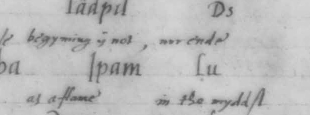

Checked: not yet

### Call 1, word 63

- Word 63: journal `ZOMDV` (conflict, p. 83); Sloane as read `zomd`; differs: letters

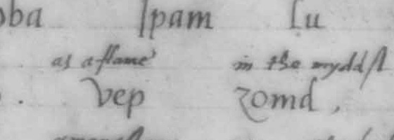

Checked: not yet

## Call 2

PDF page 2, third opening, left-hand page (scratch/sloane-pages/ms/s02-f3l.jpg). The whole call: [02.jpg](../sloane-calls/02.jpg)

### Call 2, words 3 and 4

- Word 3: journal `ZONG` (printed, p. 100); Sloane as read `zongom`; differs: word break
- Word 4: journal `OM` (printed, p. 100); Sloane as read `zongom`; differs: word break

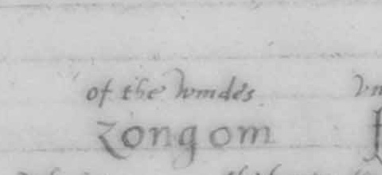

Checked: not yet

### Call 2, word 10

- Word 10: journal `IALPURG` (printed, p. 100); Sloane as read `ial-prg`; differs: letters

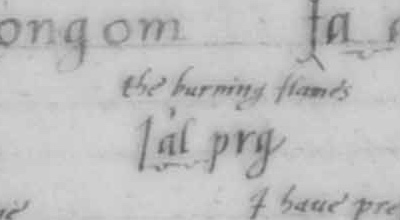

Checked: not yet

## Call 3

PDF page 2, third opening, right-hand page (scratch/sloane-pages/ms/s02-f3r.jpg). The whole call: [03.jpg](../sloane-calls/03.jpg)

- Remark on the manuscript: A faint mark stands before the 'm' (journal word 23) that could not be read as a letter.
- Remark on the manuscript: The margin beside ZACAR reads 'zod a car'.

### Call 3, word 8

- Word 8: journal `OSLONDOH` (printed, p. 97); Sloane as read `Os Lón-doh`; differs: word break

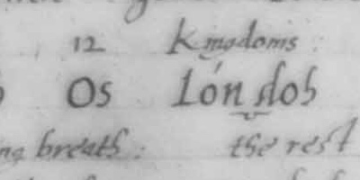

Checked: not yet

### Call 3, word 15

- Word 15: journal `TAPVIN` (printed, p. 97); Sloane as read `tá_pu-im`; differs: letters

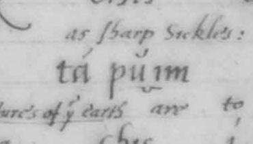

Checked: not yet

### Call 3, words 16 and 17

- Word 16: journal `QMOS` (printed, p. 97); Sloane as read `Q_mos-pleh`; differs: word break
- Word 17: journal `PLEH` (printed, p. 97); Sloane as read `Q_mos-pleh`; differs: word break

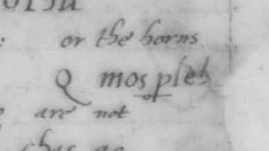

Checked: not yet

### Call 3, word 33

- Word 33: journal `HAALA` (printed, p. 96); Sloane as read `áâla`; differs: letters

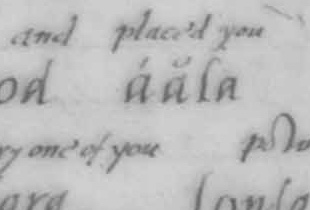

Checked: not yet

### Call 3, word 37

- Word 37: journal `VOMZARG` (printed, p. 96); Sloane as read `vomsarg`; differs: letters

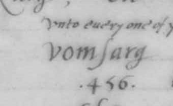

Checked: not yet

### Call 3, word 59

- Word 59: journal `ODVOOAN` (printed, p. 95); Sloane as read `od vooan`; differs: word break

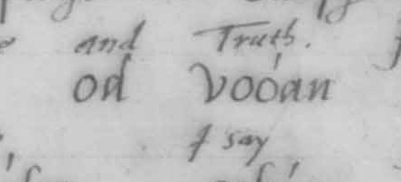

Checked: not yet

## Call 4

PDF page 2, fourth opening, left-hand page (scratch/sloane-pages/ms/s02-f4l.jpg). The whole call: [04.jpg](../sloane-calls/04.jpg)

- Remark on the manuscript: A small 'i' is written above the e of 'rest-el'.

### Call 4, word 34

- Word 34: journal `DO` (printed, p. 109); Sloane as read `od`; differs: letters

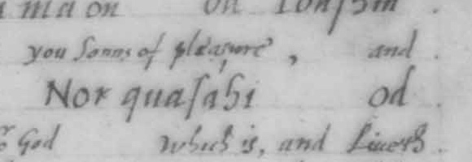

Checked: not yet

### Call 4, word 35

- Word 35: journal `FGAOSGA` (printed, p. 109); Sloane as read `F_caosga`; differs: letters

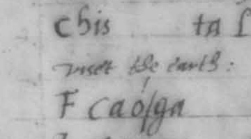

Checked: not yet

### Call 4, word 43

- Word 43: journal `ODZAMRAN` (printed, p. 109); Sloane as read `od ZAMRAN`; differs: word break

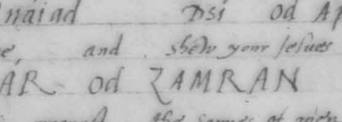

Checked: not yet

### Call 4, word 45

- Word 45: journal `RESTIL` (printed, p. 109); Sloane as read `rest-el`; differs: letters

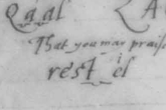

Checked: not yet

## Call 5

PDF page 2, fourth opening, right-hand page (scratch/sloane-pages/ms/s02-f4r.jpg). The whole call: [05.jpg](../sloane-calls/05.jpg)

### Call 5, word 3

- Word 3: journal `DUIV` (printed, p. 119); Sloane as read `du-i-b`; differs: letters

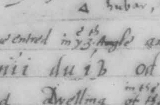

Checked: not yet

### Call 5, word 6

- Word 6: journal `TAQANIS` (printed, p. 119); Sloane as read `ta-qu-a-nis`; differs: letters

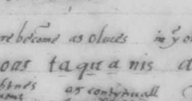

Checked: not yet

### Call 5, word 12

- Word 12: journal `PIRIPSOL` (printed, p. 119); Sloane as read `péripsol`; differs: letters

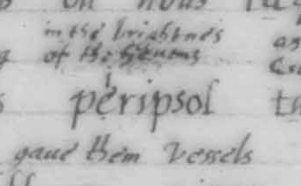

Checked: not yet

## Call 6

PDF page 2, fifth opening, left-hand page (scratch/sloane-pages/ms/s02-f5l.jpg). The whole call: [06.jpg](../sloane-calls/06.jpg)

- Remark on the manuscript: 'tbliard' is underlined, has a small o over the a, and 'f-bliard' is written beneath it.

### Call 6, word 16

- Word 16: journal `MALPURG` (printed, p. 122); Sloane as read `malprg`; differs: letters

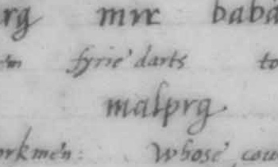

Checked: not yet

### Call 6, word 22

- Word 22: journal `FBLIARD` (corrected, p. 122); Sloane as read `tbliard`; differs: letters

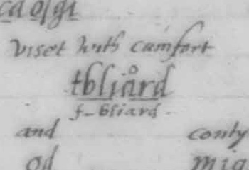

Checked: not yet

## Call 7

PDF page 2, fifth opening, right-hand page (scratch/sloane-pages/ms/s02-f5r.jpg). The whole call: [07.jpg](../sloane-calls/07.jpg)

- Remark on the manuscript: 'nuam' is written above the first 'od miam'.
- Remark on the manuscript: 'zod' is written above the final z of 'o-mi-ca-ol-z'.

### Call 7, word 3

- Word 3: journal `PARADIZ` (from_note, p. 123); Sloane as read `para-di-zod`; differs: letters

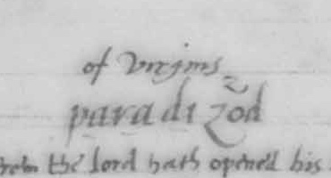

Checked: not yet

### Call 7, word 18

- Word 18: journal `ZONAR` (from_note, p. 124); Sloane as read `zonac`; differs: letters

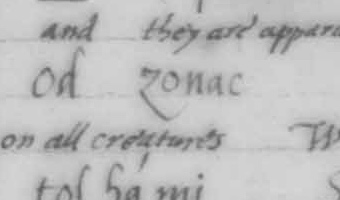

Checked: not yet

## Call 8

PDF page 3, first opening, left-hand page (scratch/sloane-pages/ms/s03-f1l.jpg). The whole call: [08.jpg](../sloane-calls/08.jpg)

- Remark on the manuscript: 'carg.' is written above 'cacrg'.
- Remark on the manuscript: Two notes in the right margin begin 'forte', one beside the line of 'Solámian trian' and one beside 'bufd'. Their second words were not read with certainty.
- Remark on the manuscript: A small mark stands above the V of 'Vrán'; it was not read.

### Call 8, word 19

- Word 19: journal `AZIAGIAR` (printed, p. 126); Sloane as read `aziágier`; differs: letters

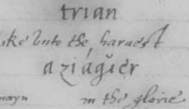

Checked: not yet

## Call 9

PDF page 3, first opening, right-hand page (scratch/sloane-pages/ms/s03-f1r.jpg). The whole call: [09.jpg](../sloane-calls/09.jpg)

- Remark on the manuscript: A small y is written above the first letter of 'ialpor'.
- Remark on the manuscript: 'Ka' is written above the 'cá' of the second 'Sob cá' and above the 'ca' of 'i córs ca'; 'zod' above the z of 'z chis' and above the z of 'ethámz'; 'kil' above the 'chíl' of 'a chíldáo'.
- Remark on the manuscript: The third letter of 'zumvi' was read as v: it has the same curl as the v of 'virq' on the next page and not the upright stroke of b.
- Remark on the manuscript: The gap in 'a_chíldáo' measures 60 pixels. It is wider than every gap measured inside a word in the manuscript (the widest is 41) and wider than the gap between 'chis' and 'pidiái' on the same line (55). It is taken as a word break by that measure: 'a' and 'chíldáo'. The journal prints the letters as one word, and its note beside them is 'A chil da o'.

### Call 9, word 3

- Word 3: journal `PURGEL` (from_note, p. 127); Sloane as read `prgel`; differs: letters

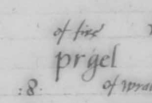

Checked: not yet

### Call 9, word 52

- Word 52: journal `ACHILDAO` (printed, p. 129); Sloane as read `a chíldáo`; differs: word break

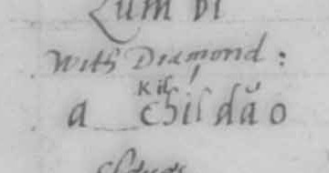

Checked: not yet

### Call 9, word 60

- Word 60: journal `ASOBAMA` (printed, p. 130); Sloane as read `a_sóbam`; differs: letters

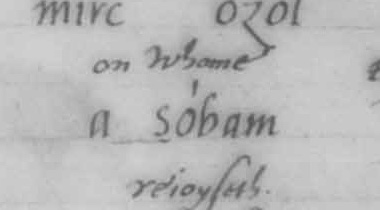

Checked: not yet

## Call 10

PDF page 3, second opening, left-hand page (scratch/sloane-pages/ms/s03-f2l.jpg). The whole call: [10.jpg](../sloane-calls/10.jpg)

- Remark on the manuscript: The manuscript writes 'virq op' where the journal data has OP VIRQ: the same two words in the other order. 'Nests' is written above 'virq' and ':22:' above 'op'.
- Remark on the manuscript: 'matb' is written after 'yolci', underlined, with '1000' above it. The journal data has no word at this place.
- Remark on the manuscript: A small faint letter, e or c, stands before 'matorb', and dots are drawn under 'ator'. No English is written above this word.
- Remark on the manuscript: A small y is written above the first letter of 'ialpon'; 'K' above the C of 'Const'; 'dg' above the g of the first 'cocasg'; ':24:' above the second 'ol'.

### Call 10, word 12

- Word 12: journal `OP` (corrected, p. 131); Sloane as read `-`; differs: not in the manuscript at this place
- After word 13: Sloane as read `op`; only in the manuscript

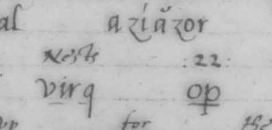

Checked: not yet

### Call 10, word 54

- Word 54: journal `MATORB` (corrected, p. 132); Sloane as read `e?_matorb`; could not read: a letter is uncertain

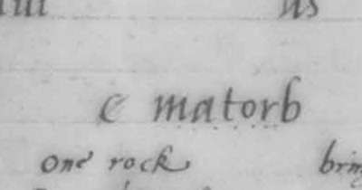

Checked: not yet

### Call 10, after word 58

- After word 58: Sloane as read `matb`; only in the manuscript

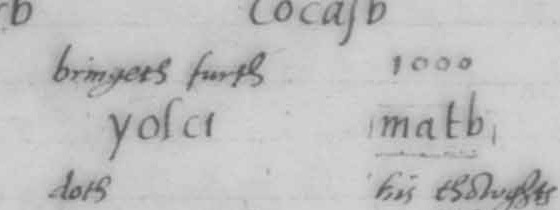

Checked: not yet

## Call 12

PDF page 3, third opening, left-hand page (scratch/sloane-pages/ms/s03-f3l.jpg). The whole call: [12.jpg](../sloane-calls/12.jpg)

### Call 12, word 22

- Word 22: journal `IVONPH` (printed, p. 135); Sloane as read `i VONPH`; differs: word break

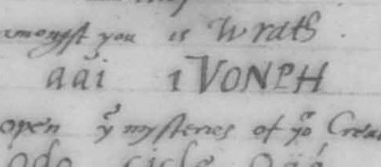

Checked: not yet

### Call 12, after word 24

- After word 24: Sloane as read `od`; only in the manuscript

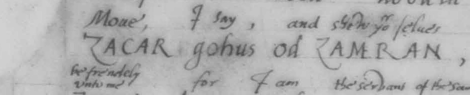

Checked: not yet

## Call 13

PDF page 3, third opening, right-hand page (scratch/sloane-pages/ms/s03-f3r.jpg). The whole call: [13.jpg](../sloane-calls/13.jpg)

### Call 13, words 23 and 24

- Word 23: journal `ZACARE` (corrected, p. 193); Sloane as read `ZACAR`; differs: letters
- Word 24: journal `CA` (printed, p. 193); Sloane as read `-`; differs: not in the manuscript at this place

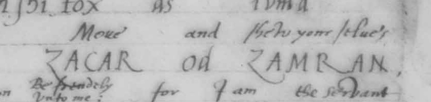

Checked: not yet

## Call 14

PDF page 3, fourth opening, left-hand page (scratch/sloane-pages/ms/s03-f4l.jpg). The whole call: [14.jpg](../sloane-calls/14.jpg)

- Remark on the manuscript: Small letters are written above 'bagíe' and above the 'ol' that follows 'mirc'; they were not read.
- Remark on the manuscript: The fourth letter of 'pasbs' was read as b: it has the closed bowl of the b in 'bagíe' beside it.

### Call 14, words 26 and 27

- Word 26: journal `ZACARE` (corrected, p. 193); Sloane as read `ZACAR`; differs: letters
- Word 27: journal `CA` (printed, p. 193); Sloane as read `-`; differs: not in the manuscript at this place

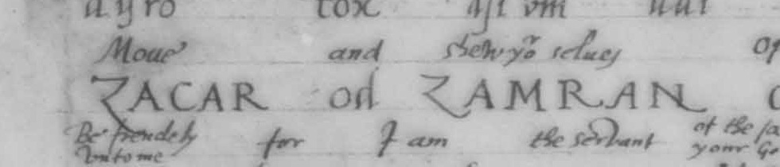

Checked: not yet

## Call 15

PDF page 3, fourth opening, right-hand page (scratch/sloane-pages/ms/s03-f4r.jpg). The whole call: [15.jpg](../sloane-calls/15.jpg)

- Remark on the manuscript: In 'dsocido' the letters between o and d were read as 'ci' with a mark above; they could also be a single a.
- Remark on the manuscript: 'darg' is underlined and has small letters above it that were not read; a small s stands above the s of 'monasci' and a small y above the first letter of 'iaíádix'.

### Call 15, word 5

- Word 5: journal `VPHAAI` (not_printed, not in the printing); Sloane as read `vpaáhi`; differs: letters

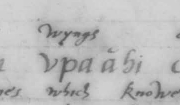

Checked: not yet

### Call 15, word 8

- Word 8: journal `DSOCIDO` (not_printed, not in the printing); Sloane as read `dsoci?do`; could not read: a letter is uncertain

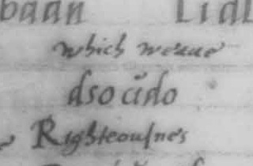

Checked: not yet

### Call 15, words 18 and 19

- Word 18: journal `ZACARE` (corrected, p. 193); Sloane as read `ZACAR`; differs: letters
- Word 19: journal `CA` (printed, p. 193); Sloane as read `-`; differs: not in the manuscript at this place

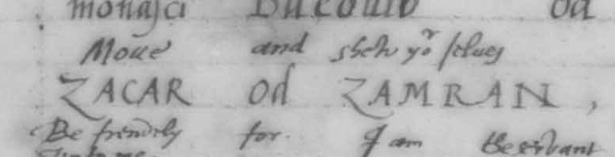

Checked: not yet

## Call 16

PDF page 3, fifth opening, left-hand page (scratch/sloane-pages/ms/s03-f5l.jpg). The whole call: [16.jpg](../sloane-calls/16.jpg)

- Remark on the manuscript: Small letters are written above the g of 'caosg', and 'yls' is written again above 'yls'. A note in the right margin beside 'ds in si' was not read.

### Call 16, words 22 and 23

- Word 22: journal `ZACARE` (corrected, p. 194); Sloane as read `ZACAR`; differs: letters
- Word 23: journal `CA` (printed, p. 194); Sloane as read `-`; differs: not in the manuscript at this place

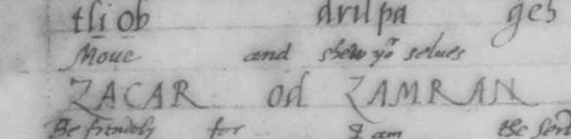

Checked: not yet

## Call 17

PDF page 3, fifth opening, right-hand page (scratch/sloane-pages/ms/s03-f5r.jpg). The whole call: [17.jpg](../sloane-calls/17.jpg)

- Remark on the manuscript: The first letter of 'Faxs' was read as F: it has a bar across the middle of the stem as well as the bar on top. The word is underlined and '7336' is written above it.

### Call 17, word 2

- Word 2: journal `DIALPERT` (from_note, p. 136); Sloane as read `dialprt`; differs: letters

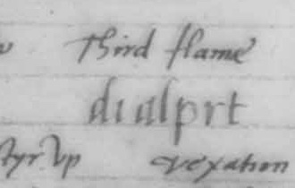

Checked: not yet

### Call 17, word 10

- Word 10: journal `TAXS` (printed, p. 135); Sloane as read `Faxs`; differs: letters

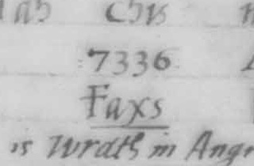

Checked: not yet

### Call 17, words 20 and 21

- Word 20: journal `ZACARE` (corrected, p. 194); Sloane as read `ZACAR`; differs: letters
- Word 21: journal `CA` (printed, p. 194); Sloane as read `-`; differs: not in the manuscript at this place

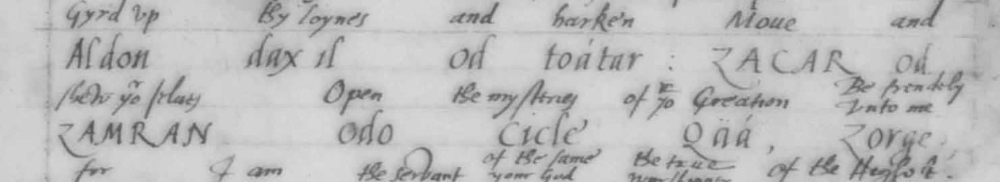

Checked: not yet

## Call 18

PDF page 3, sixth opening, left-hand page (scratch/sloane-pages/ms/s03-f6l.jpg). The whole call: [18.jpg](../sloane-calls/18.jpg)

- Remark on the manuscript: 'MOZ' is written in capitals with 'IOYE' above it. No letters stand before the M.

### Call 18, word 21

- Word 21: journal `QZMOZ` (printed, p. 137); Sloane as read `MOZ`; differs: letters

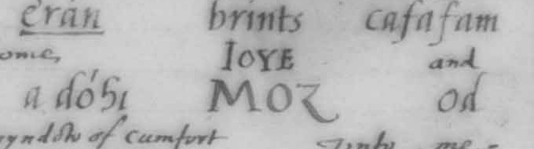

Checked: not yet

### Call 18, words 27 and 28

- Word 27: journal `ZACARE` (corrected, p. 194); Sloane as read `ZACAR`; differs: letters
- Word 28: journal `CA` (printed, p. 194); Sloane as read `-`; differs: not in the manuscript at this place

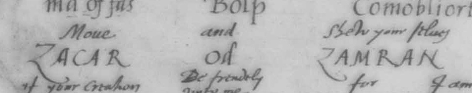

Checked: not yet

## The call of the thirty Aethyrs

PDF page 4, first opening, both pages (scratch/sloane-pages/ms/s04-f1l.jpg and s04-f1r.jpg). The whole call: [aethyrs.jpg](../sloane-calls/aethyrs.jpg)

- Remark on the manuscript: The first word was read as 'Madriax' with one i. Where the word comes again on the second page it is 'Mádríiax' with two.
- Remark on the manuscript: A small o is written above the first a of 'Sába'.
- Remark on the manuscript: Notes written above words: 's' above the c of 'nonca' and of both 'noncf'; 'do-drumni' or the like above 'dodrmni'; 'K' above the c of 'mirc'; 'dg' above 'fargt' and above 'tonug'; 'ki' above 'vnchi'; 'Ka' above 'orócha'; 'dg' above 'q ting'; 'carg' above 'cacrg'; 'x' above 'Mádríiax'. Several more were not read.

### The call of the thirty Aethyrs, word 1

- Word 1: journal `MADRIIAX` (printed, p. 201); Sloane as read `Madriax`; differs: letters

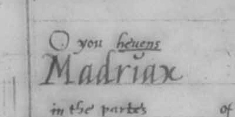

Checked: not yet

### The call of the thirty Aethyrs, word 4

- Word 4: journal `CHISMICAOLZ` (printed, p. 201); Sloane as read `chis Micáolz`; differs: word break

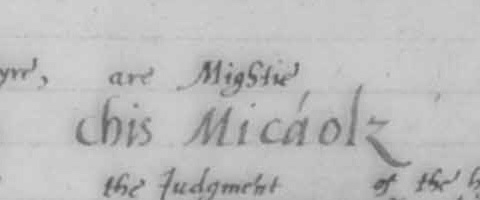

Checked: not yet

### The call of the thirty Aethyrs, word 19

- Word 19: journal `CHI` (printed, p. 201); Sloane as read `chis`; differs: letters

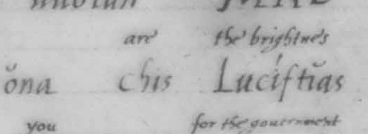

Checked: not yet

### The call of the thirty Aethyrs, word 21

- Word 21: journal `PIRIPSOL` (printed, p. 202); Sloane as read `perípsol`; differs: letters

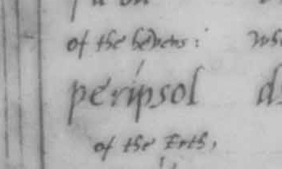

Checked: not yet

### The call of the thirty Aethyrs, word 59

- Word 59: journal `PIRIPSAX` (printed, p. 204); Sloane as read `pe_ríp_sax`; differs: letters

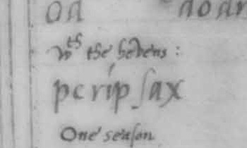

Checked: not yet

### The call of the thirty Aethyrs, word 80

- Word 80: journal `AGLTOLTORN` (printed, p. 205); Sloane as read `Ag_L_tor_torn`; differs: letters

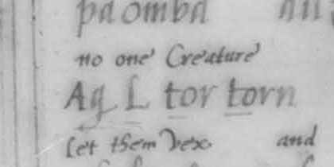

Checked: not yet
